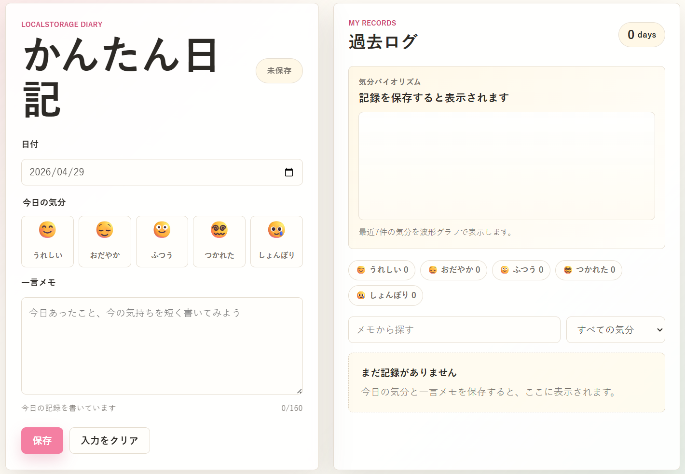

# 学習ログ

このリポジトリは、学習ログアプリに育てるための土台として使います。

HTML/CSS/JavaScriptとlocalStorageだけで動く、学習記録アプリです。

日付ごとに「今日の集中度」と「今日の学習メモ」を保存できます。保存した記録はブラウザのlocalStorageに残るため、ページを閉じても同じブラウザで再度開けば過去の学習ログを確認できます。

## 📱 デモ

🔗 [https://gigaschool.github.io/tiny-diary/](https://gigaschool.github.io/tiny-diary/)



## デモの動かし方

`index.html` をブラウザで開くだけで使えます。ビルドやサーバー起動は不要です。

```text
tiny-diary/
├── index.html
├── styles.css
├── app.js
├── README.md
└── LICENSE
```

## 機能

- 今日の日付を自動セット
- 集中度を5段階から選択
- 今日の学習メモを保存
- 日付ごとに1件の記録として保存
- 同じ日付で保存すると上書き
- 過去の学習ログ一覧表示
- 保存済み学習ログの編集
- 保存済み学習ログの削除
- 学習メモ検索
- 集中度フィルター
- 最近7件の集中度の流れを表示する集中度グラフ

## 使用技術

- HTML
- CSS
- JavaScript
- localStorage

外部ライブラリは使っていません。

## localStorage

保存キーは `tiny-diary.entries.v1` です。

データは次のような配列で保存されます。

```json
[
  {
    "id": "example-id",
    "date": "2026-04-29",
    "mood": "happy",
    "note": "AXパスポートの過去問を20問解いた",
    "createdAt": "2026-04-29T10:00:00.000Z",
    "updatedAt": "2026-04-29T10:00:00.000Z"
  }
]
```

## 集中度データ

集中度は次の5段階です。

| 値 | 表示 | スコア |
| --- | --- | --- |
| `happy` | 極（集中できた） | 5 |
| `calm` | 良（まずまず） | 4 |
| `normal` | 中（普通） | 3 |
| `tired` | 整（やや低下） | 2 |
| `sad` | 休（集中できず） | 1 |

集中度の推移では、最近7件の記録をこのスコアに変換して、SVGの波形グラフとして表示します。

## 教材で説明しやすい流れ

1. フォームから値を受け取る
2. JavaScriptの配列に学習記録データを追加する
3. `JSON.stringify` でlocalStorageへ保存する
4. `JSON.parse` でlocalStorageから読み込む
5. 配列をもとに一覧と集中度グラフを再描画する

## ファイル構成

- `index.html`: 画面の構造
- `styles.css`: レイアウトと見た目
- `app.js`: 保存、表示、編集、削除、検索、バイオリズム描画
- `README.md`: この説明ファイル
- `LICENSE`: MITライセンス

## ライセンス

MIT License
